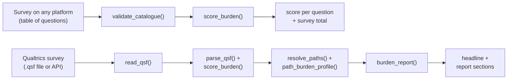

# surveyBurden

[](https://github.com/pmpk20/surveyBurden/actions/workflows/R-CMD-check.yaml)
[](https://lifecycle.r-lib.org/articles/stages.html#experimental)
[](https://opensource.org/licenses/MIT)
[](https://orcid.org/0000-0001-8550-466X)
[](https://app.codecov.io/gh/pmpk20/surveyBurden)

surveyBurden is an R package that measures how much work a survey asks
of the people who answer it. You give it a survey, and it tells you how
many burden points each question carries, where in the survey the burden
sits, and how the total changes with the route a respondent takes. If
you also have response data, it tells you how much burden each
respondent was actually shown.

The survey literature calls this objective burden. It is the work a
survey asks of respondents, measured from the questions themselves (how
many there are and how much effort each takes to answer). Perceived
burden, how burdensome respondents feel the survey to be, is measured
separately, for example by asking respondents directly ([Yan and
Williams 2022](https://doi.org/10.2478/jos-2022-0041)).

Survey designers usually judge length by counting questions or timing a
pilot. A question count gives a large grid the same weight as a yes/no
question, although the grid can carry the burden of ten or more. A pilot
timing gives one number, while respondents routed down different
branches can face very different surveys. surveyBurden puts every
question on one scale, so you can find the heavy parts of a draft, see
how much an edit removes, and compare one survey with another before it
goes into the field.

## A worked example

Burden is scored in GfS+ points. GfS stands for Gesellschaft für
Sozialforschung (Society for Social Research), the Zürich organisation
whose point system for budgeting face-to-face interviews Axhausen and
colleagues adapted to self-administered surveys ([Schmid and Axhausen
2019](https://doi.org/10.32866/7827)). Each question earns points by its
type and complexity, and the points are added up, so longer or more
complex surveys score higher. surveyBurden uses the current version of
the table, Table 1 of [Heimgartner and Axhausen
(2024)](https://doi.org/10.32866/001c.125481), and adds documented rules
for further question types, hence the “+”.

Take an agreement grid with 6 statements and a 7-point scale. Each row
is a rating with more than 5 options, which scores 3 points, so the grid
scores 6 × 3 = 18 points. The package converts points to time at 12
points per minute, so this one grid takes about a minute and a half. A
yes/no question scores 1 point, so the grid carries the burden of
eighteen of them.

Add up the questions a respondent sees and you have that respondent’s
burden. The demo survey shipped with the package comes to about 120
points (around 10 minutes), roughly a third of the 399-point median
across a benchmark of 79 survey waves scored with the GfS scheme
(Heimgartner and Axhausen 2024).

## Installation

Install the development version from GitHub.

``` r

# install.packages("pak")
pak::pak("pmpk20/surveyBurden")

# or, with remotes
# install.packages("remotes")
remotes::install_github("pmpk20/surveyBurden")
```

To work from a local clone, use
`pkgload::load_all("path/to/surveyBurden")` for one-off use, or
`R CMD INSTALL path/to/surveyBurden` to install it.

surveyBurden depends on `jsonlite`, `cli` and `tibble`. It needs `httr2`
only if you fetch surveys from the Qualtrics API.

## Quick start with a Qualtrics survey

surveyBurden reads Qualtrics surveys directly, either from a `.qsf`
export or through the Qualtrics API. One call produces the full report.
This example uses the demo survey that comes with the package.

``` r

library(surveyBurden)

qsf <- system.file("extdata", "demo_travel_survey.qsf", package = "surveyBurden")
report <- burden_report(qsf)
summary(report)
```

    #> ── Neighbourhood Travel Survey (demo) ──────────────────────────────────────────
    #> 26 questions, 12 pages, 12 blocks, 4 structural paths (2 complete).
    #> Median burden: 120 GfS+ points (range 103-143 across 2 completing paths).
    #> Expected minutes: ~10 (range 9-12).
    #> Relative to benchmark: 0.3x the median of 399 points.

The survey has four paths through it. Two are screen-outs, where the
survey ends early, and two run to the end. Burden along the complete
paths runs from 103 to 143 points. The range comes from optional
questions that the survey’s display logic shows to some respondents and
hides from others.

Printing `report` gives the full version. It adds burden by block, the
heaviest questions, readability checks, calculation certainty (which
parts of the calculation are exact and which are approximated), and
warnings. For example, the demo survey’s heaviest question is the 6 × 7
agreement grid from the worked example above, and its heaviest block is
the travel block, with 23% of all question points.
[`vignette("reading-the-report")`](https://pmpk20.github.io/surveyBurden/articles/reading-the-report.md)
explains each section of the printout.

## Surveys from other platforms

The scoring rules work for surveys from any platform. Describe your
questions in a data frame, with one row per question, its type and,
where relevant, its number of options, rows or columns. Then score it.

``` r

catalogue <- validate_catalogue(data.frame(
  question_id = c("Q1", "Q2", "Q3"),
  std_type    = c("single_choice", "matrix", "open_text"),
  n_options   = c(5L, NA, NA),
  n_rows      = c(NA, 4L, NA),
  n_cols      = c(NA, 5L, NA)
))
scored <- score_burden(catalogue)
scored[, c("question_id", "std_type", "gfs_points")]
#> # A tibble: 3 × 3
#>   question_id std_type      gfs_points
#>   <chr>       <chr>              <dbl>
#> 1 Q1          single_choice          2
#> 2 Q2          matrix                 8
#> 3 Q3          open_text              1

sum(scored$gfs_points)   # survey total in GfS+ points
#> [1] 11
```

[`validate_catalogue()`](https://pmpk20.github.io/surveyBurden/reference/validate_catalogue.md)
checks the table and fills in defaults for any columns you leave out.
[`?validate_catalogue`](https://pmpk20.github.io/surveyBurden/reference/validate_catalogue.md)
lists the question types it accepts. The questions are scored with the
same rules as a Qualtrics survey. For other platforms, you supply the
routing yourself. List which questions each path shows, and
[`path_burden()`](https://pmpk20.github.io/surveyBurden/reference/path_burden.md)
gives the burden range for each path.
[`vignette("extensions")`](https://pmpk20.github.io/surveyBurden/articles/extensions.md)
lists every column, walks through an example and explains what automatic
support for another platform would need.

## Where to start

| What you have | Start with | What you get | Guide |
|----|----|----|----|
| A survey on any platform, as a list of questions | `score_burden(validate_catalogue(catalogue))` | a score for each question and a survey total | [`vignette("extensions")`](https://pmpk20.github.io/surveyBurden/articles/extensions.md) |
| A Qualtrics survey (`.qsf` or API) | `burden_report(qsf)` | the full report, with burden across the survey’s paths | [`vignette("reading-the-report")`](https://pmpk20.github.io/surveyBurden/articles/reading-the-report.md) |
| A draft you want to shorten | [`burden_report()`](https://pmpk20.github.io/surveyBurden/reference/burden_report.md) before and after an edit | where the burden is, why, and how much an edit removes | [`vignette("survey-revision")`](https://pmpk20.github.io/surveyBurden/articles/survey-revision.md) |
| A Qualtrics response export | `respondent_burden(qsf, responses)` | the burden each respondent was shown | [`vignette("respondent-burden")`](https://pmpk20.github.io/surveyBurden/articles/respondent-burden.md) |
| A response export, to study break-off | `respondent_burden(qsf, responses, by = "block")` | for each respondent and block, whether they reached the block and the burden shown | [`vignette("respondent-burden")`](https://pmpk20.github.io/surveyBurden/articles/respondent-burden.md) |
| A response export with completion times | `validate_times(qsf, observed)` | a check of respondent burden against time taken, and a points-per-minute rate for your survey | [`vignette("calibration")`](https://pmpk20.github.io/surveyBurden/articles/calibration.md) |

[`vignette("surveyBurden")`](https://pmpk20.github.io/surveyBurden/articles/surveyBurden.md)
is the general introduction.

## How the scores are calculated



Burden is calculated in three steps.

1.  **Score each question.** Every question gets GfS+ points from its
    type and size (how many options, rows and columns it has). This is
    its **question burden**. Questions from any platform are scored with
    the same rules.
2.  **Follow the survey’s routing.** For a Qualtrics survey, the package
    reads the survey flow, branches, display logic and loops, and works
    out each **path** the design allows. Adding up the questions along a
    path gives its **path burden**. Display logic can show or hide
    questions within a path, so a path has a range of burdens.
3.  **Use response data, if you have it.** Given a response export,
    [`respondent_burden()`](https://pmpk20.github.io/surveyBurden/reference/respondent_burden.md)
    reconstructs which questions each respondent was shown and adds up
    their points. This is **respondent burden**.

Steps 1 and 2 work from the survey’s design alone. Step 3 describes what
happened in the field.

The “median” in the report describes the survey’s design. Before
fieldwork the number of people taking each branch is unknown, so the
package gives every complete path equal weight, and within a path it
gives each modelled combination of display-logic outcomes equal weight.
The result is a **structural burden profile** of the design. The package
treats each branch condition on its own, so the highest and lowest
values may come from routes whose conditions contradict each other. Once
you have responses, `burden_report(qsf, responses = "responses.csv")`
adds the distribution of respondent burden across complete responses.

surveyBurden describes the survey. Whether burden causes break-off,
satisficing or slower responses is a research question that its outputs
can help answer.
[`vignette("gfs-scoring")`](https://pmpk20.github.io/surveyBurden/articles/gfs-scoring.md)
and
[`vignette("paths-and-display-logic")`](https://pmpk20.github.io/surveyBurden/articles/paths-and-display-logic.md)
set out the method in full.

### Terms used in the documentation

Each term below has one fixed meaning across the package and its guides.
The most important distinction is between a **path**, which is a
possibility in the survey’s design, and a respondent’s path, which is
the route one person actually took.

| term | meaning |
|----|----|
| **path** | one route through the survey that its flow allows. A path is the sequence of blocks shown, given which branches are taken. It is worked out from the survey design alone. |
| **question burden** | the GfS+ points for one question, from its type and structure |
| **path burden** | the total question burden along one path. Display logic and loops can vary within a path, so a path has a range of burdens. |
| **structural burden profile** | the burden values a path’s modelled display-logic combinations produce, each with an equal model weight (each path’s weights sum to 1). The weights describe the design. Shares of respondents come from respondent burden after fieldwork. |
| **respondent burden** | the GfS+ points of every item shown to one respondent, reconstructed from their responses. It includes descriptive text and questions left blank, and counts each loop iteration ([`respondent_burden()`](https://pmpk20.github.io/surveyBurden/reference/respondent_burden.md)). |
| **calculation certainty** | for a given survey, how many parts of the calculation the model enumerates in full and how many rest on documented approximations. It diagnoses the model of the survey. |
| **readability diagnostics** | counts of long question stems, long matrix labels and long grids. They signal reading load and are reported separately from the GfS+ score. |

## Fetching a survey from Qualtrics

Set your API credentials as environment variables, then pass a survey
link or ID to
[`burden_report()`](https://pmpk20.github.io/surveyBurden/reference/burden_report.md).

``` r

Sys.setenv(
  QUALTRICS_API_KEY  = "your-api-key",
  QUALTRICS_BASE_URL = "https://yourdatacenter.qualtrics.com"
)
burden_report("https://yourorg.qualtrics.com/survey-builder/SV_xxxxxxxxxxxxxxxx/edit")
```

Only the survey ID (`SV_...`) is needed, so a survey-builder link, a
distribution link (`.../jfe/form/SV_...`) or the bare ID all work.
[`burden_report()`](https://pmpk20.github.io/surveyBurden/reference/burden_report.md)
fetches the survey’s definition (its questions and logic). Responses
come from a separate export. The credentials are read from the
environment, so they stay out of your code.

`QUALTRICS_BASE_URL` is your API datacenter, which can differ from the
address of the survey builder. You can find it in Qualtrics under
Account Settings, then Qualtrics IDs.

You can only score a survey you have access to. Reading a survey
definition through the API requires a token with the “Manage Survey”
permission on that survey, which normally means a survey in your own
account. A public survey link lets someone take the survey. To score
someone else’s survey, you need their `.qsf` export or an API token for
the account that owns it.

## Working with the report object

`report` is a structured R object, so you can pull out each part and use
it in your own analysis.

``` r

report$survey  # one row of structural counts (questions, blocks, branches, loops, paths)
report$burden  # minimum, quartiles and maximum of path burden, in points, minutes and index (below)
report$items   # one row per question, with its GfS+ points and a score_flag
report$paths   # one row per path, whether it completes, and its burden range
report$blocks  # burden by block, in survey order, with each block's share
```

`score_flag` records how each score was reached. It is `auto` when the
structure maps directly onto a GfS category, `inferred` when that
mapping needed one of the package’s documented rules, and `manual` when
a person should check the score. The `index` column in `report$burden`
is points divided by a threshold above which Heimgartner and Axhausen
(2024) found surveys to be rare (1,500 points by default). An index of 1
means the survey sits at that threshold. The settings used are stored as
attributes, `attr(report, "points_per_minute")` and
`attr(report, "rare_threshold")`.

## Functions

[`burden_report()`](https://pmpk20.github.io/surveyBurden/reference/burden_report.md)
runs the whole pipeline. The lower-level functions expose each step,
grouped here as they are on the [reference
site](https://pmpk20.github.io/surveyBurden/reference/).

| step | functions |
|----|----|
| Run everything | [`burden_report()`](https://pmpk20.github.io/surveyBurden/reference/burden_report.md), [`summary_line()`](https://pmpk20.github.io/surveyBurden/reference/summary_line.md) |
| Read a Qualtrics survey | [`read_qsf()`](https://pmpk20.github.io/surveyBurden/reference/read_qsf.md), [`fetch_qsf()`](https://pmpk20.github.io/surveyBurden/reference/fetch_qsf.md), [`as_qsf_raw()`](https://pmpk20.github.io/surveyBurden/reference/as_qsf_raw.md), [`parse_qsf()`](https://pmpk20.github.io/surveyBurden/reference/parse_qsf.md) |
| Score questions | [`classify_question()`](https://pmpk20.github.io/surveyBurden/reference/classify_question.md), [`validate_catalogue()`](https://pmpk20.github.io/surveyBurden/reference/validate_catalogue.md), [`gfs_scheme()`](https://pmpk20.github.io/surveyBurden/reference/gfs_scheme.md), [`score_burden()`](https://pmpk20.github.io/surveyBurden/reference/score_burden.md), [`suggest_choice_tasks()`](https://pmpk20.github.io/surveyBurden/reference/suggest_choice_tasks.md) |
| Resolve paths | [`resolve_flow()`](https://pmpk20.github.io/surveyBurden/reference/resolve_flow.md), [`resolve_live_blocks()`](https://pmpk20.github.io/surveyBurden/reference/resolve_live_blocks.md), [`resolve_paths()`](https://pmpk20.github.io/surveyBurden/reference/resolve_paths.md), [`classify_reachability()`](https://pmpk20.github.io/surveyBurden/reference/classify_reachability.md) |
| Path burden | [`path_burden()`](https://pmpk20.github.io/surveyBurden/reference/path_burden.md), [`path_burden_profile()`](https://pmpk20.github.io/surveyBurden/reference/path_burden_profile.md), [`path_burden_traversals()`](https://pmpk20.github.io/surveyBurden/reference/path_burden_traversals.md), [`traversal_stability()`](https://pmpk20.github.io/surveyBurden/reference/traversal_stability.md) |
| Respondent burden | [`respondent_burden()`](https://pmpk20.github.io/surveyBurden/reference/respondent_burden.md), [`read_responses()`](https://pmpk20.github.io/surveyBurden/reference/read_responses.md), [`exposure_person_period()`](https://pmpk20.github.io/surveyBurden/reference/exposure_person_period.md) |
| Diagnostics | [`calculation_certainty()`](https://pmpk20.github.io/surveyBurden/reference/calculation_certainty.md), [`validate_times()`](https://pmpk20.github.io/surveyBurden/reference/validate_times.md), [`survey_summary()`](https://pmpk20.github.io/surveyBurden/reference/survey_summary.md) |

Every function has a help page
([`?burden_report`](https://pmpk20.github.io/surveyBurden/reference/burden_report.md),
[`?score_burden`](https://pmpk20.github.io/surveyBurden/reference/score_burden.md)
and so on).

## Limitations

- Some question types fall outside the published GfS table. For these
  the package applies a documented rule and flags the question as
  `inferred`.
- The original GfS scheme predates modern web survey interfaces.
- The `.qsf` stores the words of descriptive text, and the package
  estimates the screen lines they fill at 12 words per line. You can
  change this with `burden_report(words_per_line = ...)`.
- Display logic can only be reconstructed as far as the `.qsf` encodes
  it. Unusual or externally controlled logic may need checking by hand.
- The conversion from points to minutes is a rule of thumb.
  [`vignette("calibration")`](https://pmpk20.github.io/surveyBurden/articles/calibration.md)
  shows how to check it against your own timings and fit a rate for your
  survey.

## Contributing

Bug reports, questions and pull requests are welcome. See
[`.github/CONTRIBUTING.md`](https://github.com/pmpk20/surveyBurden/blob/main/.github/CONTRIBUTING.md).
Contributors are expected to follow the [Code of
Conduct](https://github.com/pmpk20/surveyBurden/blob/main/CODE_OF_CONDUCT.md).

surveyBurden is an independent project, separate from Qualtrics and
every other survey platform. Support comes from this repository.

## Citation

Run `citation("surveyBurden")`, or see
[`CITATION.cff`](https://github.com/pmpk20/surveyBurden/blob/main/CITATION.cff).

## Licence

MIT. Peter King, Institute for Transport Studies, University of Leeds.
